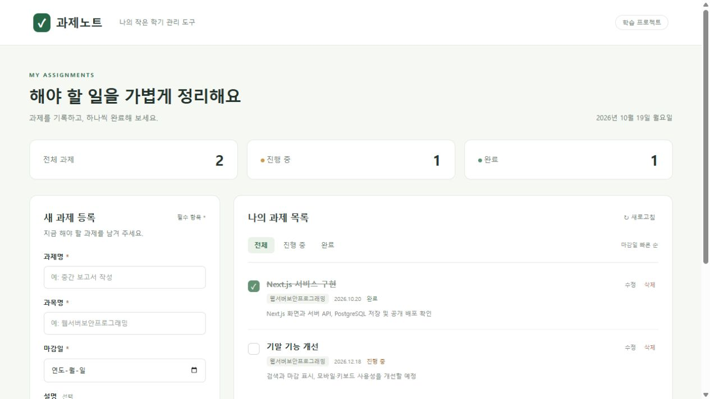

# 과제노트

웹서버보안프로그래밍 과목의 Next.js 기반 풀스택 웹 서비스 프로젝트입니다. 과제 등록, 조회, 수정, 완료 상태 변경과 삭제를 지원합니다.

## 개발 상태

2026년 10월 19일 Next.js 서비스의 공개 배포와 Neon PostgreSQL 연결을 완료했습니다. 로컬과 공개 환경에서 입력 검증·API 통합 테스트가 각각 17개 통과했습니다. 집계에는 통합 검증 상위 테스트 1개가 포함됩니다.

- 공개 서비스: https://task-note-next.vercel.app/
- 공개 소스: https://github.com/steve2514/task-note-next
- 배포 구성: Vercel Hobby + Neon Free PostgreSQL

처음 접속하면 빈 목록이 보이며 직접 과제를 등록할 수 있습니다. 다른 브라우저의 과제는 보이지 않습니다.

중간보고 자료에는 공개 배포와 실제 검증 결과를 반영했습니다. 중간 구현 범위와 기말까지의 개선 계획은 [docs/roadmap.md](docs/roadmap.md)에 기록했습니다. 계획한 기능을 구현 완료 기능으로 표시하지 않습니다.

## 기술 구성

- Next.js 16.4.2 App Router와 TypeScript
- React 화면과 Next.js Route Handler API
- 로컬: Node.js 내장 SQLite를 사용하는 파일 DB
- 배포: `DATABASE_URL`을 통한 Neon PostgreSQL 연결
- 브라우저마다 별도 익명 세션을 부여하여 과제 데이터 분리

화면은 `src/app/page.tsx`에서 서버 렌더링하고 `src/components/task-dashboard.tsx`에서 사용자 조작을 처리합니다. 서버 렌더링과 Route Handler 모두 `src/lib/db.ts`의 데이터 접근 함수를 사용합니다. 브라우저에서 DB에 직접 접속하지 않습니다.



## 로컬 실행

Node.js **24.x**와 pnpm 10.11.0을 사용합니다.

```sh
pnpm install --frozen-lockfile
pnpm dev
```

[http://127.0.0.1:3000](http://127.0.0.1:3000)에 접속합니다. 이 PC에서는 `실행하기.cmd`도 사용할 수 있습니다.

별도 환경변수 없이 실행하면 `data/tasks.db`에 저장합니다. 브라우저의 HttpOnly 쿠키가 과제 소유자를 구분하며 쿠키를 유지하면 새로고침과 서버 재시작 후에도 같은 과제를 조회할 수 있습니다. 쿠키를 삭제하거나 다른 브라우저를 쓰면 기존 과제에 접근하지 못합니다. 계정 로그인이나 여러 기기 간 동기화는 제공하지 않습니다.

프로덕션 실행을 확인하려면 다음 명령을 사용합니다.

```sh
pnpm build
pnpm start
```

## 검증

```sh
pnpm typecheck
pnpm test
```

서버를 실행한 상태에서 아래처럼 API 검증을 포함합니다.

```powershell
$env:TEST_BASE_URL = 'http://127.0.0.1:3000'
pnpm test
```

Unix 계열에서는 `TEST_BASE_URL=http://127.0.0.1:3000 pnpm test`를 사용합니다. 환경변수가 없으면 API 통합 검증은 건너뛰고 입력 검증만 실행합니다.

검증은 별도 쿠키로 만든 가상 과제만 사용하며 생성한 과제는 마지막에 삭제합니다. 등록, DB 재조회, 수정, 완료 전환, 삭제, 다른 세션의 읽기·변경 제한, 입력값과 요청 출처, 요청 크기를 검증합니다.

## API

| 메서드 | 경로 | 기능 |
| --- | --- | --- |
| GET | `/api/tasks` | 현재 브라우저의 과제 조회 및 익명 세션 초기화 |
| POST | `/api/tasks` | 과제 등록 |
| PUT | `/api/tasks/{id}` | 과제 수정 |
| PATCH | `/api/tasks/{id}/status` | 완료 상태 변경 |
| DELETE | `/api/tasks/{id}` | 과제 삭제 |
| GET | `/api/health` | DB 연결 상태 확인 |

변경 요청은 `X-Requested-With: task-note` 헤더를 사용합니다. 등록·수정 JSON은 `title`, `course`, `due_date`, 선택 항목 `description`으로 구성합니다. 상태 변경은 `{"is_completed":true}` 형태입니다. 다른 세션의 ID를 지정해도 읽거나 수정할 수 없습니다.

## 보안 처리

- 서버에서 필수값, 길이, 실제 날짜와 JSON 자료형을 확인합니다.
- SQL 매개변수로 값을 바인딩하고 문자열 결합으로 쿼리를 만들지 않습니다.
- React 텍스트 출력의 기본 이스케이프를 사용합니다.
- HttpOnly·SameSite 쿠키를 사용하며 Vercel 배포에서는 Secure도 설정합니다.
- 세션 토큰 자체는 DB에 저장하지 않고 SHA-256 해시를 소유자 식별자로 사용합니다.
- 변경 요청의 출처와 사용자 정의 헤더를 확인하고 본문을 16 KiB로 제한합니다.
- nosniff, 프레임 차단과 Referrer-Policy 헤더를 적용합니다.
- DB 접속 정보와 로컬 DB, 환경변수 파일은 Git에 포함하지 않습니다.

학습용 익명 세션 서비스입니다. 실제 개인정보나 중요한 비공개 자료는 입력하지 않습니다.

## 공개 배포와 과제 종료 후 삭제

배포 절차와 자원 삭제 방법은 [DEPLOYMENT.md](DEPLOYMENT.md)에 정리했습니다. 배포에는 외부 PostgreSQL이 필요하며, Vercel에서는 DB 환경변수가 없을 때 로컬 SQLite로 대체하지 않습니다. 제출할 정보는 실제 생성된 GitHub 저장소 주소와 공개 서비스 주소입니다.
